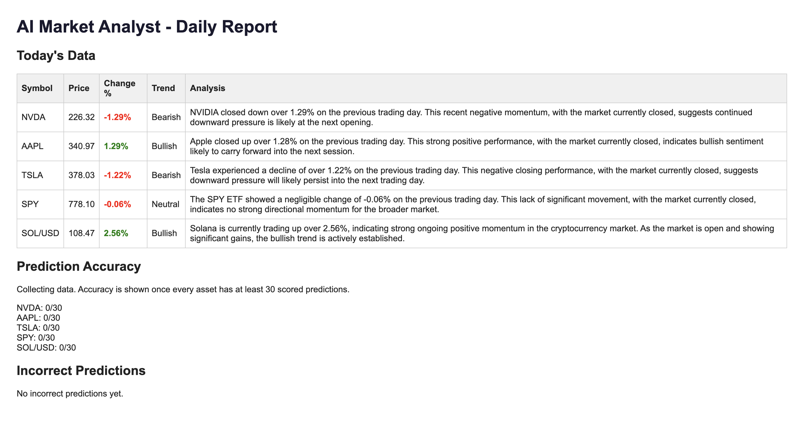

# AI Market Analyst: can an LLM predict daily market moves?

A daily experiment that logs an LLM's trend calls on five assets and scores them against what the market actually did. Not investment advice.

## The question

Given a day's price data, can a language model call tomorrow's direction (Bullish, Bearish or Neutral) better than a simple rule can? Before relying on an LLM for a decision, I wanted to know how often it is right, so I built a way to measure it.

## How it works

Every day, a GitHub Actions job:

1. Pulls quotes for NVDA, AAPL, TSLA, SPY and SOL/USD from Twelve Data.
2. Asks Gemini for a trend call on each one.
3. Scores yesterday's call against what the market actually did, and appends it to `data/accuracy_log.jsonl`.
4. Commits the new data to this repo, so every prediction has a timestamp in the git history.

## Decisions

- **Neutral counts as correct only if the move was within ±0.5%.** My first version marked every Neutral as correct, which inflated the accuracy. The 0.5% is a threshold I chose by hand.
- **Stale data is skipped.** On weekends the stock quotes do not change, so those days are not scored.
- **No backfilling.** The model already knows what happened in the past, so predictions for past dates would not be a test.

## Status

Running since October 13, 2026. I am not publishing an accuracy number yet: with one prediction per asset per day, the sample is too small to mean anything. I will report results at 30+ predictions per asset, next to simple baselines such as "same direction as yesterday".

## Limitations

- Five assets, one prediction a day, so the results will be noisy for a long time.
- The model only sees the latest day's price and change, so the call is close to one-day momentum.
- Crypto trades 24/7, so SOL/USD is scored against a partial-day move (the quote is taken at 06:30 UTC), while stocks are scored against a full trading day. The two are not directly comparable.

## How I built it

I had some prior experience working with LLM responses in code from a course, and I wanted to build a full Java project that talks to live market APIs and tracks its own performance over time.

I set the scope, picked the assets, decided to measure accuracy instead of just predicting, and switched from Alpha Vantage to Twelve Data when I hit rate limits on the free tier. I used Claude for starter code and debugging, and I ran, tested and connected everything myself.

In October a review with Claude turned up two bugs in how results were scored: Neutral predictions were always counted as correct, and weekend data was compared against a quote that had not changed. I fixed both, added error handling so one failing symbol does not stop the run, and set up the daily run.

## Run it

Java 21 and Maven. Set `TWELVE_DATA_API_KEY` and `GEMINI_API_KEY` (as environment variables or in a `.env` file), run `Main.java`, and open `report.html`.